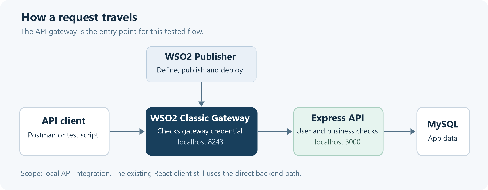
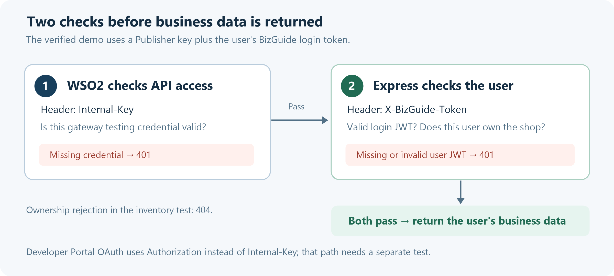

# Adding WSO2 API Manager to a small-business app

*A simple walkthrough of the BizGuide integration, from API setup to 43 passing checks.*

A shop owner uses BizGuide to manage products, record sales and track expenses.
The app stores its data in MySQL and exposes its features through an Express API.

This project adds WSO2 API Manager 4.7.0 in front of that API. It gives the API a
managed entry point and a place to describe, publish and deploy its operations.
The backend still handles user accounts, stock and business ownership.

The integration was tested locally on **16 November 2026**. All **36 API
operations** passed through WSO2, across **43 HTTP checks**. This article explains
the setup, the authentication mistake encountered along the way and what the
test results actually prove.

[Project source](https://github.com/AmanaFaizal/AI-Software-Requirement-Database-Generator-for-SMEs)

## 1. Understand the request path

Imagine a request to list a shop's products. It first reaches WSO2. Once the
gateway accepts it, Express checks the logged-in user and reads the shop's data.



*Figure 1. The gateway manages API access. Express handles the business rules.*

| Part | Job in this project |
| --- | --- |
| API client | Sends requests from Postman or the test script |
| WSO2 Publisher | Manages the API definition and deployment revisions |
| WSO2 Classic Gateway | Checks the gateway credential and forwards requests |
| Express backend | Checks the user JWT and business ownership |
| MySQL | Stores users, products and business records |

The existing React frontend still calls the backend directly. The gateway flow
described here was tested with API requests, not with a completed browser OAuth login.

## 2. Start the backend in gateway mode

The local setup uses Node.js, MySQL, WSO2 API Manager 4.7.0 and JDK 21.
JDK 21 is one of the supported runtimes listed in the
[WSO2 4.7.0 release notes](https://apim.docs.wso2.com/en/latest/get-started/about-this-release/).

From the project directory, install the backend packages:

```powershell
cd backend
npm.cmd install
if (!(Test-Path .env)) { Copy-Item .env.example .env }
```

Copy the example only when creating a new `.env`; keep an existing configuration.
Create the MySQL database and fill in its name, username and password in `.env`.
Also replace the example `JWT_SECRET` with a long, random secret.

For this integration, the relevant setting is:

```dotenv
BIZGUIDE_AUTH_MODE=gateway
```

Then start the server:

```powershell
npm.cmd run start:gateway
```

This command explicitly selects gateway mode. That matters because an old
environment variable in a terminal can otherwise keep the server in direct mode.

The launcher is small:

```javascript
require('dotenv').config({
  path: require('node:path').join(__dirname, '../.env')
});
process.env.BIZGUIDE_AUTH_MODE = 'gateway';
require('../server');
```

Check the startup message for `Authentication mode: gateway`. The backend runs
at `http://localhost:5000` in this example.

## 3. Import and deploy the API in WSO2

Start API Manager with `JAVA_HOME` pointing to JDK 21, then open Publisher at
`https://localhost:9443/publisher`.

Use the definition in `backend/openapi/wso2-inventory.json`. It contains all 36
operations, grouped by feature: Authentication, Businesses, Products,
Categories, Dealers, Purchases, Invoices, Sales, Expenses, Reminders, Reports
and Health.

In Publisher:

1. Create a REST API from the OpenAPI file, or update the definition of an existing API.
2. Set the context to `/bizguide` and the version to `1.0.0`.
3. Set the backend endpoint to `http://localhost:5000`.
4. Keep API authentication enabled.
5. Save, create a revision and deploy it to Default Gateway.
6. Publish the API so it is available in Developer Portal.

The URL now includes the gateway address, context, version and backend route:

```text
https://localhost:8243/bizguide/1.0.0/api/health
                      └─ context ─┘       └─ backend route
```

For clarity, the parts are:

| Part | Value |
| --- | --- |
| Gateway | `https://localhost:8243` |
| Context and version | `/bizguide/1.0.0` |
| Backend route | `/api/health` |

Saving a definition and deploying a revision are separate steps. A file can
contain a route while the running gateway still uses an older revision.

## 4. Give each credential one job

This was the most important part of the integration. A gateway credential and
a BizGuide user token answer different questions.



*Figure 2. A protected request must pass both checks.*

The verified run used Publisher's **Internal-Key** for the gateway check.
The user JWT came from BizGuide's login endpoint.

```http
Internal-Key: <Publisher test key>
X-BizGuide-Token: Bearer <JWT returned by BizGuide login>
```

For a Developer Portal OAuth client, the gateway header would instead be:

```http
Authorization: Bearer <WSO2 access token>
X-BizGuide-Token: Bearer <BizGuide login JWT>
```

That OAuth path needs its own subscribed application and verification. The
results below establish the **Publisher Internal-Key path**.

Express chooses the user-token header from its configured mode:

```javascript
const headerName = mode === 'gateway'
  ? 'x-bizguide-token'
  : 'authorization';

const header = req.headers[headerName];
```

This is an excerpt, not the whole middleware. The implementation also checks
the Bearer format, rejects duplicate credentials, verifies the JWT with HS256
and requires a valid user ID. Controllers then check business ownership.

## 5. Log in, then call a protected API

In Publisher, open **Try Out** and obtain an Internal API Key. Use a disposable
account for the example. Register it first if it does not already exist.

For `POST /api/auth/register`, send:

```json
{
  "name": "Demo User",
  "email": "demo@example.test",
  "password": "replace-with-a-test-password"
}
```

Then call `POST /api/auth/login` with the same email and password. A successful
login returns `200` with a response shaped like this:

```json
{
  "message": "Logged in successfully.",
  "token": "<BizGuide JWT>",
  "user": {
    "user_id": 1,
    "name": "Demo User",
    "email": "demo@example.test"
  }
}
```

This response is illustrative; the ID and token vary. Copy the returned
`token`, including neither quotes nor extra spaces.

For `GET /api/auth/me`, supply:

```http
GET /bizguide/1.0.0/api/auth/me
Internal-Key: <Publisher test key>
X-BizGuide-Token: Bearer <BizGuide JWT>
```

In Try Out, paste `Bearer <BizGuide JWT>` into the `X-BizGuide-Token` input.
If that input is missing, import the latest definition and deploy a new revision.
The definition describes this header explicitly:

```json
{
  "name": "X-BizGuide-Token",
  "in": "header",
  "required": true,
  "schema": { "type": "string" }
}
```

Once `/api/auth/me` succeeds, create a business with `POST /api/businesses`:

```json
{
  "business_name": "Demo Coffee Shop",
  "business_type": "Retail"
}
```

Use the returned `business_id` in later product and sales requests.

## 6. Understand the 401 that appeared during testing

Initially, login succeeded but `/api/auth/me` and business creation returned:

```json
{ "message": "No token provided. Please log in." }
```

Those calls contained an Internal-Key but no BizGuide user JWT. The gateway
accepted the request; Express could not identify a logged-in user.

The fix was to run the backend in gateway mode and send the login JWT in
`X-BizGuide-Token`. Sending the Internal-Key alone could not satisfy that check.

The response source helps narrow down a failure:

| Response | What to check |
| --- | --- |
| WSO2 `900902` / Missing Credentials | Is the gateway credential present? |
| WSO2 `900901` / Invalid Credentials | Is the gateway key valid? Inspect the gateway log. |
| Backend “No token provided” | Is the user JWT in the header selected by the backend mode? |
| Backend “Invalid or expired token” | Is the login JWT valid and unexpired? |

## 7. Run the checks and read the results

The test script is `backend/scripts/verify-integration.js`. It creates its own
test users and business records, so it does not depend on somebody's existing account.

To repeat the Publisher-key run, configure these local `.env` entries:

```dotenv
WSO2_GATEWAY_URL=https://localhost:8243/bizguide/1.0.0
WSO2_ACCESS_TOKEN=
WSO2_INTERNAL_KEY=<Publisher test key>
```

Leave `WSO2_ACCESS_TOKEN` empty for this path: the runner uses it in preference
to Internal-Key when both are set. Keep real keys out of Git and screenshots.

For the local self-signed certificate, configure certificate trust or explicitly
set `WSO2_ALLOW_SELF_SIGNED=true`. The runner allows that exception only for
loopback hosts. It is a local testing setting.

From `backend`, run:

```powershell
npm.cmd test
npm.cmd run verify:gateway
```

The live runner writes a report to `docs/evidence/gateway-live.json`. It saves
request paths, status codes and pass/fail results, without tokens or response bodies.

The completed run on **16 November 2026** produced these results:

| Check | Actual result |
| --- | --- |
| Backend operations exercised through WSO2 | **36 of 36 passed** |
| HTTP checks, including repeat calls and negative tests | **43 of 43 passed** |
| Gateway credential used | Publisher Internal-Key |
| No gateway credential | `401` |
| No BizGuide user JWT | `401` |
| Invalid BizGuide user JWT | `401` |
| Another user's inventory | `404` |
| Separate automated test groups | **4 passed** |

The 43 checks exceed the 36 operations because the script also repeats some
calls and tests failures. An expected `401` or `404` counts as a passing check.

It also checks business behavior. A test product starts with 20 units. Selling
2 units leaves **18**. At a selling price of 175 per unit, the sales total is
**350**. With purchases of 1,000 and expenses of 50, the current report formula
returns **350 − 1,000 − 50 = −700**. These assertions passed. This checks the
application's formula, not the accounting suitability of that formula.

The runner deletes its disposable product, category, dealer, reminder and
expense fixtures. It tests business deletion on a separate empty business.
Generated accounts and financial records remain because there are no individual
purchase, sale or invoice deletion APIs. Run it against a test database.

## What this project demonstrates

BizGuide now has a verified path from an API client through WSO2 to Express and
MySQL. The test results show successful business operations and rejection of
several unauthorized requests.

There is still work before production: Developer Portal OAuth verification,
frontend OAuth, rate-limit testing, production TLS, monitoring and backend
network isolation. Broader validation tests and database migrations are also
needed. A custom header alone does not stop clients from reaching an exposed backend.

The key lesson from this integration is practical: define what the gateway
checks, define what the backend checks, and test both. Importing every route
is useful; running real requests is what confirms the integration works.

## Code, evidence and references

- [BizGuide repository](https://github.com/AmanaFaizal/AI-Software-Requirement-Database-Generator-for-SMEs)
- [Project setup](WSO2-PROJECT.md)
- [Recorded live results](evidence/gateway-live.json)
- [WSO2 gateway overview](https://apim.docs.wso2.com/en/latest/api-gateway/platform-gateway-capability/)
- [WSO2 Client Credentials guide](https://apim.docs.wso2.com/en/latest/api-security/key-management/authentication/grant-types/client-credentials-grant/)
