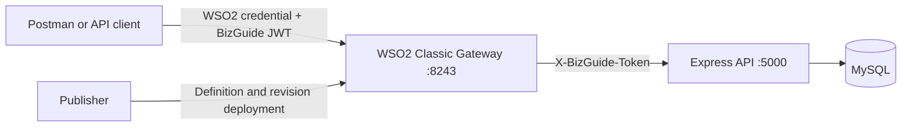

# BizGuide with WSO2 API Manager

BizGuide is an SME business application with user accounts, business ownership,
inventory, categories, suppliers, purchases, sales, invoices, expenses, reminders
and sales reports. WSO2 API Manager 4.7.0 provides the managed API entry point.

## Architecture

The React frontend currently uses the direct-backend transport. The gateway demo
uses API clients; browser OAuth login has not been implemented. Do not describe
the existing frontend as fully integrated with WSO2.

## Authentication

There are two checks. WSO2 validates the gateway credential; Express validates
the user JWT returned by registration or login and checks business ownership.

| Purpose | Normal API client | Publisher Try Out |
| --- | --- | --- |
| Gateway authentication | `Authorization: Bearer <WSO2 access token>` | Publisher-managed `Internal-Key` |
| BizGuide user identity | `X-BizGuide-Token: Bearer <login JWT>` | Same user-token header |

An Internal-Key working in Publisher does not demonstrate OAuth subscription
validation in Postman. Record which credential was used in each demo.

The backend has explicit `direct` and `gateway` modes. In gateway mode it does
not accept the WSO2 Authorization header as a user identity. This prevents the
two JWTs from being confused. Network isolation is still required if clients
must never bypass the gateway; the custom header alone does not enforce that.

## Reproduce

1. Install JDK 21 and WSO2 API Manager 4.7.0. Configure `JAVA_HOME` and start API Manager.
2. Configure the existing MySQL database using `backend/.env.example`. Keep secrets in `.env`.
3. From `backend`, run `npm.cmd run start:gateway`. This explicitly selects gateway mode even if the parent terminal has an old direct-mode variable.
4. In Publisher, import `backend/openapi/wso2-inventory.json`, context `/bizguide`, version `1.0.0`, backend endpoint `http://localhost:5000`. Keep API authentication enabled.
5. Save the updated definition, create a revision and deploy it to Default Gateway. Publish the API.
6. In Developer Portal, subscribe an application and generate OAuth credentials with Client Credentials enabled. Generate an access token.
7. Add `WSO2_ACCESS_TOKEN` to `backend/.env`. The automated runner reads it locally; do not put it in screenshots or Git. For the local self-signed TLS certificate only, set `WSO2_ALLOW_SELF_SIGNED=true`, or configure certificate trust.
8. From `backend`, run `npm.cmd run verify:gateway`. This creates disposable test accounts and records, exercises all 36 operations, and writes `docs/evidence/gateway-live.json` without credentials or response bodies.

In Publisher Try Out, call login first, copy the returned `token`, and paste
`Bearer <token>` into the explicit `X-BizGuide-Token` parameter of protected
operations. Re-import the latest definition if that input is missing.

## Verification and evidence

- `npm.cmd test` checks token separation, inventory ownership and OpenAPI route coverage.
- `docs/evidence/backend-live.json` records a real MySQL-backed run of all 36 operations in direct mode. It is backend evidence, not gateway evidence.
- `docs/evidence/gateway-live.json` now records a passing run through WSO2 for all 36 operations, using Publisher Internal-Key. All 43 HTTP checks passed, including missing gateway credentials, missing/invalid user JWTs, and another user's inventory access. Developer Portal OAuth subscription validation still needs a separate run with `WSO2_ACCESS_TOKEN`.
- The runner verifies stock falls from 20 to 18 after a sale, and checks sales/report totals. It tests business deletion on an empty fixture, not a business containing financial records.
- Each run creates two generated test users and retains a test business with financial records because there are no purchase/sale/invoice deletion APIs. Do not run against production data. Individual disposable products/categories/dealers/reminders/expenses are deleted during the run.

For screenshots, show the published API and deployed revision, a successful
gateway health request, login, a protected inventory response, and rejected
unauthorized requests. Hide every token and credential. A short video should
show the same sequence and explain both authentication checks.

## Scope and limitations

This is a local development integration. Frontend OAuth, enforced backend
network isolation, production TLS, monitoring, token rotation, and demonstrated
rate limiting remain future work. The existing server startup performs
`sequelize.sync({ alter: true })`; use managed migrations before production.
The checks are smoke tests, not a complete audit of every write controller's
input validation or relationship ownership.

## Internship submission

The [WSO2 engineering internship page](https://wso2.com/careers/internships/engineering-intern/)
lists product use in a real-world project as 2 points and a blog post as 1 point,
with at least 3 points required. WSO2 decides whether evidence meets its criteria.
Use this guide and actual passing reports as project evidence. Review and
personalize `docs/WSO2-BLOG.md` before publishing; an unpublished article
does not establish a completed blog contribution.

Official references:

- [Gateway choices](https://apim.docs.wso2.com/en/latest/api-gateway/platform-gateway-capability/)
- [Client Credentials grant](https://apim.docs.wso2.com/en/latest/api-security/key-management/authentication/grant-types/client-credentials-grant/)
